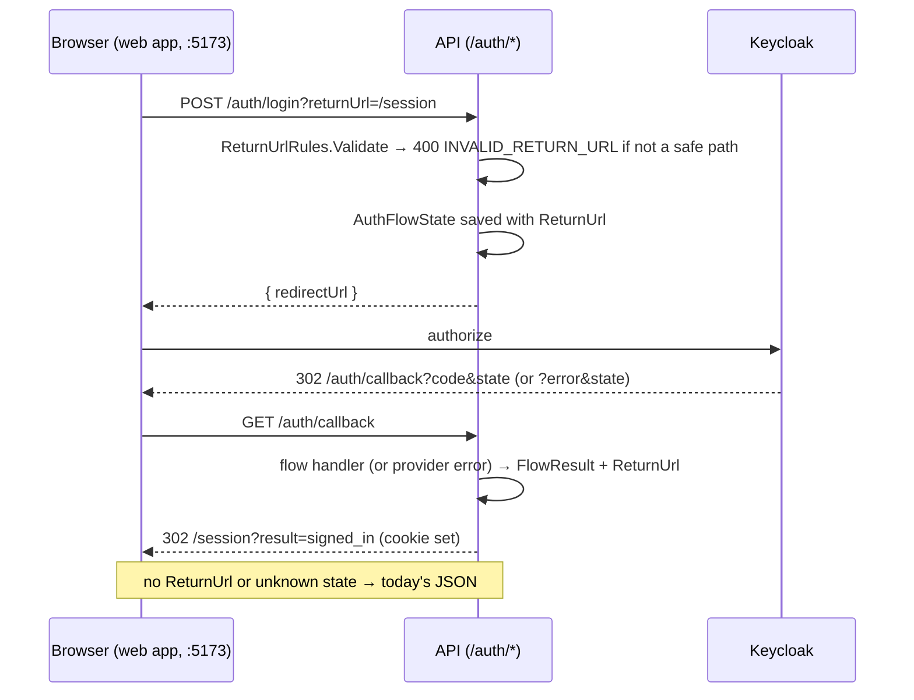

# Design: Post-Sign-In Redirect Back to the Client App (GU-87)

Requirements: `requirements.md` in this folder.

## Overview



Three pieces:
1. **Services:** `ReturnUrlRules` (validation), the return URL carried on `FlowResult`, and a new `HandleProviderErrorAsync` on `IAuthFlowService`.
2. **API:** `CallbackRedirect` (outcome → query string) and the `Callback` action choosing between a redirect and JSON; the four initiation actions take `returnUrl`.
3. **Web app:** the Session placeholder shows the landing values.

No schema change: `AuthFlowState.ReturnUrl` (max 2048) exists.

## 1. Return URL rules (`GroundUp.Auth.Services/ReturnUrlRules.cs`)

```csharp
public static class ReturnUrlRules
{
    public const int MaxLength = 2048;

    /// Null or empty → (true, null): no return URL. Otherwise (true, url) or (false, null).
    public static bool TryNormalize(string? returnUrl, string callbackPath, out string? normalized);
}
```

Rules, in order (any failure is a refusal):
1. null, empty or whitespace → no return URL (allowed).
2. Length ≤ 2048.
3. First character `/`, and the second character is not `/` or `\` (blocks `//evil.com` and `/\evil.com`, which browsers treat as another host).
4. No `\` anywhere, no `#`, no character below U+0020 and no U+007F (blocks header splitting and odd parsing).
5. `Uri.TryCreate(value, UriKind.Relative, out _)` succeeds.
6. The path part (before `?`) is not the callback path and does not start with the callback path followed by `/` or `?`, compared case-insensitively.

The value is stored unchanged (no decoding or re-encoding), so what the app sent is what it gets back.

Public and in Services so an SDK caller (or an app's own endpoint) can check a value the same way. The rules are deliberately narrow: an allowlist for other origins would be a separate option later.

## 2. Initiation

`AuthFlowService.InitiateFlowAsync` calls `ReturnUrlRules.TryNormalize(request.ReturnUrl, options.CallbackPath, ...)` first. On failure it returns `OperationResult.Fail("The return URL must be a path on this site.", 400, AuthErrorCodes.InvalidReturnUrl)`. This is before the authorization URL is built and before the flow state is saved, so nothing is created and no state cookie is set.

`AuthErrorCodes.InvalidReturnUrl = "INVALID_RETURN_URL"` and `AuthErrorCodes.IdpError = "IDP_ERROR"` are added.

Endpoints (`[FromQuery] string? returnUrl = null` on each):

| Endpoint | Change |
|---|---|
| `POST /auth/login` | `new FlowInitiationRequest(FlowType.Login, ForceLogin: forceLogin, ReturnUrl: returnUrl)` |
| `POST /auth/signup` | the same `ReturnUrl` on the request it already builds |
| `POST /auth/invitations/accept` | `IInvitationAcceptanceService.StartAsync(token, forceLogin, returnUrl, httpContext, ct)` passes it into its `FlowInitiationRequest` |
| `POST /auth/join-links/join` | `IJoinLinkAcceptanceService.StartAsync(token, forceLogin, returnUrl, httpContext, ct)` likewise |

The two `StartAsync` signatures gain `string? returnUrl` before `httpContext`. Their callers are the two controllers and tests. The refusal comes back through their existing error mapping (`{ error, errorCode }` with status 400).

## 3. Carrying the return URL to the callback

`FlowResult` gains two init properties:

```csharp
public string? ReturnUrl { get; init; }   // from the flow state; set by AuthFlowService, not by handlers
public string? IdpError { get; init; }    // the provider's error code, already checked against ^[a-z_]{1,64}$
```

`AuthFlowService.HandleCallbackAsync` sets `ReturnUrl` on every result it returns once it knows the flow state:

| Step | Today | After |
|---|---|---|
| State cookie missing / mismatched | `Error(CSRF_STATE_MISMATCH)` before any lookup | look up the state by token (read only, no change), then `Error(CSRF_STATE_MISMATCH) with { ReturnUrl = found?.ReturnUrl }` |
| State not found | `Error(STATE_NOT_FOUND)` | unchanged (no return URL) |
| Consumed, expired, failed, consume race | `Error(...)` | `... with { ReturnUrl = flowState.ReturnUrl }` |
| No handler | `Error(NO_HANDLER)` | with the return URL |
| Handler result | `flowResult` | `flowResult with { ReturnUrl = consumedState.ReturnUrl }` |

The cookie check still happens first and still refuses; the extra lookup only finds where to send the browser. The state is not consumed or changed on a cookie mismatch, as today.

`ReturnUrl` is set once, in `AuthFlowService`, so handlers do not need to know about it and a handler cannot point the browser elsewhere. The existing `FlowResult.RedirectUrl` (set by no handler today) stays as it is for the JSON body.

### The identity provider's error

New on `IAuthFlowService`:

```csharp
Task<OperationResult<FlowResult>> HandleProviderErrorAsync(
    string state, string error, string? errorDescription, HttpContext httpContext, CancellationToken ct = default);
```

1. Look up the flow state by `state`. Not found → `Error(IDP_ERROR)` with no return URL.
2. If the state cookie matches the `state` parameter **and** the state is Pending, mark it failed (`MarkFailedAsync(id, "Identity provider error: {error}")`; the repository only moves Pending to Failed) and clear the state cookie. Without a matching cookie the state is left alone, so a third party who somehow knew a state token could not fail someone else's sign-in.
3. Log at Information: flow state id, the provider's `error`, and `errorDescription` truncated to 200 characters (it is provider text, not user input, but it is not put in the URL).
4. Return `Error(IDP_ERROR, "The identity provider reported an error.", 400) with { ReturnUrl = state's, IdpError = error if it matches ^[a-z_]{1,64}$ }`.

## 4. The callback action and the redirect

`AuthController.Callback` gains `[FromQuery] string? error` and `[FromQuery(Name = "error_description")] string? errorDescription`:

```
if state is blank → 400 JSON "Missing code or state parameter." (as today)
if error is present → result = HandleProviderErrorAsync(...)
else if code is blank → 400 JSON (as today)
else → result = HandleCallbackAsync(...)

if result.Success && result.Data.ReturnUrl is not null
    → Redirect(CallbackRedirect.Build(result.Data.ReturnUrl, result.Data))   // 302
else
    → today's JSON (unchanged code path; IDP_ERROR gives 400 { error, errorCode, message })
```

`Redirect(string)` sends a relative `Location`, which the browser resolves against the host it called (port 5173 through the proxy, or a tenant subdomain). The API never builds an absolute URL, so there is nothing to spoof through the Host header.

### `CallbackRedirect` (`GroundUp.Auth.Api/CallbackRedirect.cs`)

```csharp
internal static class CallbackRedirect
{
    public static string Build(string returnUrl, FlowResult result);
}
```

- Split `returnUrl` at the first `?` into path and query.
- Parse the query with `QueryHelpers.ParseQuery`; remove `result`, `error`, `alreadyMember` and `idpError` (Requirement 2.2).
- Add the outcome:

| `FlowResult` | Added |
|---|---|
| `IsSuccess`, not tenantless, `AlreadyMember` false | `result=signed_in` |
| `IsSuccess`, not tenantless, `AlreadyMember` true | `result=signed_in`, `alreadyMember=true` |
| `IsTenantless`, `RequiresTenantSelection` true | `result=tenant_picker` |
| `IsTenantless`, `RequiresTenantSelection` false | `result=no_tenant` |
| not `IsSuccess` | `error=<ErrorCode>`, plus `idpError=<IdpError>` when set |

- Rebuild with `QueryHelpers.AddQueryString` (values URL-encoded). Kept parameters keep their order; the outcome goes last.
- Never adds `Token`, `ErrorMessage` or anything else from the result.

Tenantless results come first in the check, because a tenantless `FlowResult` is also `IsSuccess`.

## 5. Web app

`src/routes/session.tsx` gets a search schema and shows the values above the placeholder:

```ts
const sessionSearchSchema = z.object({
  result: z.enum(['signed_in', 'tenant_picker', 'no_tenant']).optional().catch(undefined),
  alreadyMember: z.coerce.boolean().optional().catch(undefined),
  error: z.string().regex(/^[A-Z_]{1,64}$/).optional().catch(undefined),
  idpError: z.string().regex(/^[a-z_]{1,64}$/).optional().catch(undefined),
});
```

The schema lives in `src/features/session/sessionSearch.ts` (with a unit test) so GU-89 reuses it. The page shows an MUI `Alert`: success for `signed_in` (and "already a member" when set), info for `tenant_picker` and `no_tenant`, error with the code for `error` (and `idpError`). A value that does not match is dropped, so a crafted URL cannot put arbitrary text on the page (React escapes it anyway). Landing with a result refreshes the session query (`onSessionChanged`), since a sign-in just happened.

TESTING.md Part 2 ("The return URL") uses Swagger on port 5173: `POST /auth/login?returnUrl=/session`, open the `redirectUrl`, sign in, and land on `/session?result=...`; then `returnUrl=https://example.com` gives `400 INVALID_RETURN_URL`.

## 6. Tests

**Unit (`GroundUp.Tests.Unit`):**
- `ReturnUrlRulesTests` (theory data): allowed `/`, `/session`, `/invite/abc?org=acme`, `/a%20b`; none for null, `""`, `"  "`; refused `http://evil.com`, `https://evil.com/x`, `//evil.com`, `/\evil.com`, `/a\b`, `/a#b`, `/a\nb`, `/a\u007fb`, 2049 characters, `/auth/callback`, `/AUTH/CALLBACK?x=1`, `/auth/callback/x`, `javascript:alert(1)`, `session` (no leading slash). Allowed: `/auth/callbackish` (only the exact path or a sub-path is refused).
- `CallbackRedirectTests`: each table row; existing query kept (`/invite/abc?org=acme` → `...?org=acme&result=signed_in`); existing `result`/`error` replaced; encoding (`error` values are codes, but the builder encodes anyway); no token or message in the output.
- `AuthFlowServiceTests` (existing class): invalid return URL refused before the URL builder or the state service is called; valid one passed to `InitiateAsync`; `HandleCallbackAsync` puts the return URL on the handler's result and on consumed, expired and cookie-mismatch errors; `HandleProviderErrorAsync` marks failed only with a matching cookie and a Pending state, keeps `IdpError` only when it matches the pattern.
- `AuthControllerTests`: `Callback` redirects when `ReturnUrl` is set and returns today's JSON when not; provider error path; `Login` and `Signup` pass `returnUrl` through.
- The two acceptance services pass `returnUrl` into their requests.

**Integration (`GroundUp.Tests.Integration`, mock identity provider):**
- Login with `returnUrl=/session`: the callback answers `302`, `Location: /session?result=signed_in`, and sets the auth cookie.
- Login with `returnUrl=https://example.com`: `400 INVALID_RETURN_URL` and no `AuthFlowStates` row for the request.
- Invitation flow with a return URL, signed in as the wrong email: `302` to `...?error=INVITATION_EMAIL_MISMATCH`.
- Provider error: `GET /auth/callback?error=access_denied&state=<state>` with the state cookie → `302` to `...?error=IDP_ERROR&idpError=access_denied`, and the row is Failed.
- Existing callback tests (no return URL) pass unchanged.

**Web:** `sessionSearch.test.ts`: valid values kept, unknown `result` dropped, a lower-case or long `error` dropped.

## 7. Documentation

- ARCHITECTURE.md: a "Returning to the app after sign-in" part under the auth notes: the rules, the outcome table, the JSON fallback, `IDP_ERROR`, and that the redirect never carries the token.
- MANUAL_TESTING.md (API guide): one note in "Running requests" that `returnUrl` exists and that without it nothing changes.
- The web app's TESTING.md Part 2 (above).

## Risks and choices

- **Cookie mismatch now reads the state row.** A read by an unguessable token, with no change; the response is the same error, delivered as a redirect to a path the same client chose earlier.
- **Relative `Location`.** Allowed by RFC 9110 and handled by every browser. It avoids building an absolute URL from the Host header.
- **`StartAsync` signature change** on two public interfaces. Their only implementations are internal, and their callers are in this repo.
- **Provider errors without a state.** A callback with `error` but no `state` stays the "missing state" 400; there is no flow to attach it to.

## Files

Changed: `AuthFlowService.cs`, `IAuthFlowService.cs`, `FlowResult.cs`, `AuthErrorCodes.cs`, `InvitationAcceptanceService.cs`, `IInvitationAcceptanceService.cs`, `JoinLinkAcceptanceService.cs`, `IJoinLinkAcceptanceService.cs`, `AuthController.cs`, `InvitationAcceptanceController.cs`, `JoinLinkAcceptanceController.cs`, ARCHITECTURE.md, MANUAL_TESTING.md, the web app's `session.tsx` and TESTING.md. New: `ReturnUrlRules.cs`, `CallbackRedirect.cs`, `sessionSearch.ts`, and the tests above. About 25 files; one PR.

Task groups:
1. Rules, error codes, initiation (service and four endpoints), with unit tests.
2. Callback: `FlowResult` additions, `HandleCallbackAsync` changes, `HandleProviderErrorAsync`, `CallbackRedirect`, the `Callback` action, with unit and integration tests.
3. Web app landing check, docs, full check, PR.
