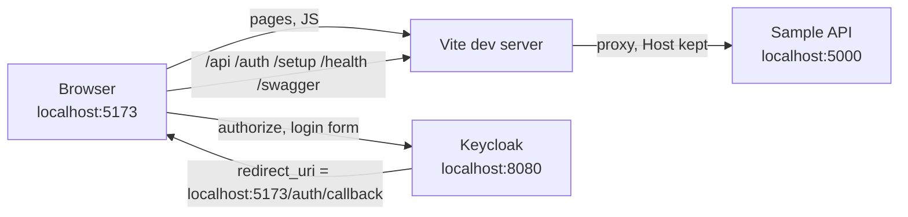

# Design: Sample Web App Scaffold, API Client and Request Inspector (GU-86)

Requirements: `requirements.md` in this folder.

## Overview

A Vite dev server on `http://localhost:5173` serves the React app and proxies the API paths to the sample API on `http://localhost:5000`. The browser only ever talks to port 5173, so the API's cookies, SameSite rules, CSRF and the Keycloak redirects all happen on one origin, as they would for a deployed client.



The API builds `redirect_uri` from the request's Host (`AuthFlowService`), so with the Host kept, Keycloak sends the browser back to `localhost:5173/auth/callback`. The proxy forwards that to the API, which sets the `AuthToken` cookie on the 5173 origin. Until GU-87, the browser then shows the callback's JSON.

## Versions

Checked against the npm registry on 2026-11-27. All pinned exactly in `package.json`.

| Package | Version | Notes |
|---|---|---|
| react, react-dom | 19.3.1 | |
| vite | 8.4.0 | |
| @vitejs/plugin-react | 6.3.0 | needs Vite 8 |
| typescript | 6.0.3 | see below |
| @mui/material, @mui/icons-material | 9.6.0 | with @emotion/react 11.14.0, @emotion/styled 11.14.1 |
| @fontsource/roboto | 5.3.0 | MUI's default font, bundled instead of a Google Fonts link |
| @tanstack/react-query | 5.108.4 | plus react-query-devtools (dev only) |
| @tanstack/react-router | 1.170.46 | plus router-plugin 1.169.0 and react-router-devtools (dev only) |
| zod | 4.6.7 | search-parameter schemas |
| vitest | 5.1.2 | node environment; no DOM needed for the client tests |
| eslint | 10.x, with typescript-eslint 8.74.0, eslint-plugin-react-hooks, @tanstack/eslint-plugin-query | |

**TypeScript 6.0.3, not 7.** typescript-eslint 8.74.0 supports TypeScript `>=4.8.4 <6.1.0`, so lint cannot run on 7 yet. 6.0.3 is the newest version it supports, which is newer than the "latest 5.x" fallback in Requirement 1.4; I chose it because it is the closest to 7 that the whole toolchain accepts. Move to 7 when typescript-eslint supports it.

**zod 4 without the adapter.** `@tanstack/zod-adapter` still requires zod 3. TanStack Router accepts Standard Schema validators directly, and zod 4 implements Standard Schema, so routes pass the zod schema to `validateSearch` with no adapter. The first task confirms this with a typed search parameter on one route; if it fails, fall back to zod 3 with the adapter.

## Project layout

```
samples/GroundUp.Sample.Web/
  .nvmrc                 22
  .env.example           GROUNDUP_API_URL=http://localhost:5000
  package.json, package-lock.json
  vite.config.ts         proxy, router plugin, allowed hosts
  vitest.config.ts       (or the test block in vite.config.ts)
  tsconfig.json, tsconfig.app.json, tsconfig.node.json
  eslint.config.js
  index.html
  README.md              how to run, folder conventions, rules
  TESTING.md             the web app's testing manual
  src/
    main.tsx             providers: theme, QueryClient, RouterProvider
    theme.ts
    queryClient.ts
    router.ts            createRouter with the generated tree and context
    routeTree.gen.ts     generated by the router plugin, committed
    routes/              file-based routes (one file per page)
      __root.tsx         layout: app bar, nav, session banner, inspector
      index.tsx          Home
      wizard.tsx         Setup (placeholder, GU-88)
      session.tsx        Session (placeholder, GU-89)
      members.tsx        (placeholder, GU-90)
      invitations.tsx    (placeholder, GU-90)
      join-links.tsx     (placeholder, GU-90)
      roles.tsx          (placeholder, GU-97)
      settings.tsx       (placeholder, GU-91)
      data.tsx           (placeholder, GU-92)
      diagnostics.tsx    (placeholder, GU-93)
    api/
      client.ts          apiFetch: the one way to call the API
      csrf.ts            in-memory CSRF token
      errors.ts          ApiError and parseErrorBody
      operationResult.ts isOperationResult, unwrap
      inspector.ts       request history store and masking
      types.ts           shared DTO types (MeDto, TenantDto, ...)
      auth.ts            endpoint functions: getMe, getMyTenants
    components/
      AppLayout.tsx, NavMenu.tsx
      ErrorPanel.tsx
      RequestInspector.tsx
      SessionBanner.tsx
      Placeholder.tsx
    features/
      session/
        sessionQuery.ts  query options, useSession, onSessionChanged
  tests next to the code: *.test.ts
```

**Rules (in the README):**
- Pages never call `fetch`. They call endpoint functions in `api/` through TanStack Query.
- One folder per feature under `features/` for its queries, mutations and components; the route file stays thin.
- **App routes never start with a proxied prefix** (`/api`, `/auth`, `/setup`, `/health`, `/swagger`), or the dev server would send them to the API. That is why the setup page is `/wizard`. A unit test walks the route tree and fails on a clash.
- New API paths that the app calls must be added to the proxy list.

`routeTree.gen.ts` is committed so `tsc` and lint work on a fresh clone before the dev server has run. Lint ignores it.

## Dev server and proxy

`vite.config.ts`:

```ts
const env = loadEnv(mode, process.cwd(), '');
const target = env.GROUNDUP_API_URL ?? 'http://localhost:5000';
const proxied = ['/api', '/auth', '/setup', '/health', '/swagger'];

export default defineConfig({
  plugins: [tanstackRouter({ target: 'react', autoCodeSplitting: true }), react()],
  server: {
    port: 5173,
    strictPort: true,
    allowedHosts: ['localhost', '.groundup.test'],
    proxy: Object.fromEntries(proxied.map(p => [p, { target, changeOrigin: false, xfwd: true }])),
  },
});
```

- `changeOrigin: false` keeps the browser's Host (`localhost:5173`, or `acme.groundup.test:5173` for Part 12), which Requirement 2.2 needs.
- `xfwd: true` adds `X-Forwarded-For/Proto/Host`. The API does not use forwarded headers today, so this is informational.
- Cookies and `Set-Cookie` pass through unchanged. The API sets them without a port, so they apply to the 5173 origin. `CookieSecure` is already `false` in Development.
- `strictPort` makes a busy port fail instead of moving to 5174, which Keycloak would reject.
- Key matching: Vite matches a proxy key as a path prefix, so `/auth` also matches `/authors`. The route clash test covers app routes; the API has no such paths today.

**Keycloak.** `realm.json` adds `http://localhost:5173/auth/callback` to `redirectUris`, `http://localhost:5173` to `webOrigins`, and `http://localhost:5173/` to `post.logout.redirect.uris`. TESTING.md tells you to add the same three in the Keycloak admin console for an existing realm, plus `http://*.groundup.test:5173/...` only when running Part 12-style subdomain tests (Keycloak needs each exact host).

## API client

### `apiFetch`

```ts
type ApiResponse<T> = { data: T; status: number; headers: Headers; correlationId: string | null };

apiFetch<T>(path: string, options?: {
  method?: 'GET' | 'POST' | 'PUT' | 'PATCH' | 'DELETE';
  body?: unknown;              // JSON-encoded
  headers?: Record<string, string>;
  correlationId?: string;      // sent as X-Correlation-Id
  signal?: AbortSignal;
}): Promise<ApiResponse<T>>     // throws ApiError
```

Steps for one call:
1. Build the request: `credentials: 'same-origin'`, `Accept: application/json`, JSON body and `Content-Type` when a body is given, the optional correlation ID.
2. For POST, PUT, PATCH and DELETE, attach the CSRF token (below).
3. Record the start in the inspector.
4. `fetch`. A thrown error (network, abort) becomes `ApiError` with status 0 and a plain message; aborts are rethrown as is so TanStack Query can cancel.
5. Read the body as text, then parse JSON if it is non-empty and the content type is JSON. Keep the raw text for the inspector if parsing fails.
6. If the status is `403` and the error code is `CSRF_VALIDATION_FAILED` and this is the first attempt: drop the token, fetch a new one, and repeat from step 2 once.
7. Record the result in the inspector.
8. Failure (non-2xx): throw `parseErrorBody(status, body, correlationId)`.
9. Success: return `unwrap(body)` as `data`, with the status, headers and correlation ID.

### CSRF (`csrf.ts`)

- State: `token: string | null` and `pending: Promise<string | null> | null`, module-level, never persisted.
- `getCsrfToken()`: returns the token, or fetches `GET /auth/csrf` once (concurrent callers share `pending`). `200` gives `{ token }`. `401` means nobody is signed in: return `null`, and the request goes without the header. That is correct, because only cookie-authenticated requests need it (the public invitation and join-link endpoints, `/auth/login` and `/auth/signup` work without a session).
- `clearCsrfToken()`: sets both to null.
- `onSessionChanged()` (in `features/session`) calls `clearCsrfToken()` and invalidates the session queries. The auth endpoint functions that change the user or tenant (set-tenant, logout, organizations, leave, refresh) call it after they succeed; GU-89 adds those functions. Sign-in itself happens through a full-page redirect, which reloads the app and so clears memory anyway.
- The CSRF fetch itself is recorded in the inspector like any other call, with the token masked.

### Errors (`errors.ts`)

```ts
class ApiError extends Error {
  status: number;            // 0 for network errors
  errorCode: string | null;
  errors: string[];          // validation messages, flattened
  correlationId: string | null;
  body: unknown;             // the parsed body, for the inspector and debugging
}
```

`parseErrorBody` reads, in this order:

| Body | message | errorCode | errors |
|---|---|---|---|
| `OperationResult` (`success: false`, has `statusCode`) | `message` | `errorCode` | `errors ?? []` |
| Exception middleware `{ message, errorCode, correlationId }` | `message` | `errorCode` | `[]` |
| Auth controllers `{ error, errorCode }` | `error` | `errorCode` | `[]` |
| `ProblemDetails` (`title`, `status`, optional `detail`, `errors`) | `detail ?? title` | `null` | each `errors[field]` entry as `field: message` |
| Empty, non-JSON or unknown | `HTTP {status} {statusText}` | `null` | `[]` |

The correlation ID comes from the `X-Correlation-Id` response header, falling back to a `correlationId` field in the body.

### OperationResult (`operationResult.ts`)

`isOperationResult(body)`: an object with a boolean `success` and a numeric `statusCode`. `unwrap(body)` returns `body.data` for an OperationResult, otherwise the body. Pages that need the OperationResult's `message` on success (rare) can call `apiFetch` with `{ raw: true }`, which skips unwrapping. Paged endpoints return `PaginatedData` inside `data`; pages read the pagination headers from `ApiResponse.headers`.

## Server state

`queryClient.ts`:

```ts
new QueryClient({
  defaultOptions: {
    queries: {
      retry: (count, err) => !(err instanceof ApiError && err.status >= 400 && err.status < 500) && count < 1,
      refetchOnWindowFocus: false,   // a test tool: refresh on purpose, not when switching to Keycloak
      staleTime: 0,
    },
    mutations: { retry: false },
  },
  queryCache: new QueryCache({ onError: handleUnauthorized }),
  mutationCache: new MutationCache({ onError: handleUnauthorized }),
});
```

`handleUnauthorized`: on `ApiError` with status 401, set the session query's data to `null` (signed out), unless the failing query is the session query itself.

**Session** (`features/session/sessionQuery.ts`):
- `sessionQueryOptions`: key `['session']`, fetches `GET /auth/me`; `401` returns `null` instead of throwing, so "signed out" is a normal state, not an error.
- `myTenantsQueryOptions`: key `['session', 'tenants']`, `GET /auth/me/tenants`, enabled only when signed in. Invalidating `['session']` refreshes both.
- `useSession()` returns the session and the current tenant's name.
- The root route's loader calls `queryClient.ensureQueryData(sessionQueryOptions)`, so every page renders with the session known. The router context carries the `queryClient`.

## Components

**ErrorPanel.** An MUI `Alert` (severity error) with the status and message, the error code as a chip, the errors list, and the correlation ID with a copy button. `401 REAUTH_REQUIRED` adds a "Sign in again" button linking to `/session` (the GU-89 page). Used by every page for query and mutation errors.

**RequestInspector.** A drawer at the bottom, toggled from the app bar with a badge showing the number of calls. A table of calls, newest first; selecting one shows the request and response headers and bodies as formatted JSON. Buttons: clear, copy as JSON.
- Store (`api/inspector.ts`): an in-memory ring buffer of 100 entries with `subscribe`/`getSnapshot`, read through `useSyncExternalStore`. No extra library.
- Masking happens when an entry is recorded, so unmasked values never enter the store. Headers: `Authorization`, `Cookie`, `Set-Cookie`, `X-CSRF-Token` become `***`. Bodies: any key whose name contains `token`, `password` or `secret` (case-insensitive, at any depth, including inside arrays) has its value replaced with `***`. Note that `fetch` cannot see `Set-Cookie` in the browser at all; the rule is there so nothing changes if that ever stops being true.

**SessionBanner.** A strip under the app bar:
- Signed out: "Not signed in", with a link to `/session`.
- Signed in: email, current tenant name (or "No current tenant"), roles as chips, and "expires in m:ss" counting down from `expiresAt` (a one-second interval, only while mounted). Past expiry it shows "expired" in warning colour; it does not refresh (GU-89).
- Times are compared with the browser clock. A skewed clock makes the countdown wrong but nothing else.

**AppLayout and NavMenu.** MUI `AppBar` with the app name, the host the app is on, and the inspector toggle; a permanent `Drawer` on the left with the areas from Requirement 7.1, using TanStack Router `Link` so links are type-checked. The root route's `notFoundComponent` renders a not-found page.

**Placeholder.** Title, one line saying which story builds the page, and a link to that Jira story.

**Home.** Links: Swagger (`/swagger`, same origin through the proxy), Keycloak admin (`http://localhost:8080/admin/master/console/#/groundup`), the web app's testing manual on GitHub, and the API guide. It also shows `window.location.host`.

**Theme.** MUI's default theme with `CssBaseline`, Roboto from `@fontsource/roboto`. No custom design work.

## API change: session times on `/auth/me`

`AuthController.Me` adds three fields to its anonymous response:

```csharp
issuedAt = ReadUnixClaim("iat"),
expiresAt = ReadUnixClaim("exp"),
authTime = ReadUnixClaim("auth_time"),
```

`ReadUnixClaim(type)` reads `HttpContext.User.FindFirst(type)`, parses it as Unix seconds and returns `DateTimeOffset?` (UTC), or null when missing or unparseable. The tokens are read with `MapInboundClaims = false`, so the claim names are the raw JWT names. The same fields work for a Keycloak principal (tenant-picker state), which also carries `iat` and `exp`.

Tests (`AuthControllerTests`): all three present; `auth_time` missing; an unparseable value returns null; existing fields unchanged.

Docs: ARCHITECTURE.md gets one line in the sessions section ("`GET /auth/me` returns `issuedAt`, `expiresAt` and `authTime` so a browser client can show the session without reading the HttpOnly cookie").

## Tests

Vitest, node environment, `fetch` replaced with `vi.fn()` per test. Files and cases:

- `api/csrf.test.ts`: first unsafe call fetches the token once (concurrent calls share it); GET never fetches it; 401 from `/auth/csrf` sends without the header; `clearCsrfToken` forces a new fetch.
- `api/client.test.ts`:
  - sends `X-CSRF-Token` on POST, PUT, PATCH, DELETE
  - `403 CSRF_VALIDATION_FAILED` refetches and retries once; a second 403 is thrown
  - another 403 is not retried
  - unwraps OperationResult `data`; returns non-OperationResult bodies as is; `raw: true` skips unwrapping
  - exposes headers (`X-Total-Count`) and the correlation ID
  - sends a caller's correlation ID
- `api/errors.test.ts`: each row of the error table, plus a network failure (status 0) and an unreadable JSON body.
- `api/inspector.test.ts`: header masking; body masking at depth and in arrays; case-insensitive key match; ring buffer keeps the newest 100; clear.
- `routes/routes.test.ts`: no route path starts with a proxied prefix.
- `features/session/sessionQuery.test.ts`: 401 from `/auth/me` gives `null`; `onSessionChanged` clears the CSRF token and invalidates `['session']`.

The .NET unit tests for `/auth/me` are listed above. The .NET suites run as usual.

## Testing manual (TESTING.md)

Structure, in the API guide's style:
- **How to use this guide.** The same test users as the API guide (Sam, Alice, Bob, Carol). A state table that later parts extend.
- **Before you start.** Docker; migrations; the sample API on port 5000 (F5); `npm install` and `npm run dev` in `samples/GroundUp.Sample.Web`; open `http://localhost:5173`; the three Keycloak URIs for port 5173 (new realm: already there; existing realm: add them in the admin console).
- **Part 1: The scaffold.**
  1. The layout and navigation; each placeholder names its story; an unknown URL shows not found.
  2. Signed out: the banner says so.
  3. Sign in through Swagger (`/swagger` on port 5173, `POST /auth/login`, open `redirectUrl`), then come back to `/`: the banner shows the user, tenant, roles and a countdown. (GU-89 replaces this with the sign-in page.)
  4. The inspector lists `/auth/me` and `/auth/me/tenants`; tokens are masked.
  5. An error: open a page that calls a tenant endpoint while tenantless, or call `/api/members` without the permission (from Home's test button, below), and check the panel shows the status, error code and correlation ID, and that the same ID is in the inspector and the API log.
  6. A cookie POST without manual CSRF (Home's test button), and the CSRF retry after signing in as another user.
- **Parts to come:** one line per page story (GU-88, GU-89, GU-90, GU-97, GU-91, GU-92, GU-93).

**Home test buttons.** To make Part 1 testable before any real page exists, Home has a small "Checks" card with two buttons: "Call a tenant endpoint" (`GET /api/members`) and "Send a cookie POST" (`POST /auth/refresh`, which needs CSRF and is harmless). Their results show in an `ErrorPanel` or a success message. GU-93 (diagnostics) can move them.

## Risks and choices

- **Proxy prefix clash.** Covered by the route test and the README rule.
- **Cookie domain on localhost.** The API writes the cookie with the configured default domain; with `localhost` it works for `localhost:5173` exactly as it does for `localhost:5000` today. Subdomain tests need `groundup.test`, as in the API guide's Part 12.
- **TypeScript 6 instead of 7.** A small, reversible pin; noted above.
- **Committing `routeTree.gen.ts`.** It can show up in diffs when routes change; that is expected and reviewed with the route change.
- **Not in CI.** `npm test` and `npm run build` run locally for now; GU-62 adds them to CI.

## Files

New, all under `samples/GroundUp.Sample.Web/` (about 35 files including config and placeholders). Changed: `src/GroundUp.Auth.Api/Controllers/AuthController.cs`, `tests/GroundUp.Tests.Unit/Auth/AuthControllerTests.cs`, `keycloak/realm.json`, `ARCHITECTURE.md`, `.gitignore` (`node_modules`, `dist`, `.env`).

Suggested task groups (one commit each, one PR overall):
1. Project, tooling, proxy, router skeleton with placeholders, layout, theme, route clash test.
2. API client, CSRF, errors, inspector, with their tests.
3. Session query, banner, ErrorPanel, Home checks; the `/auth/me` change and its .NET tests; `realm.json`.
4. README, TESTING.md, ARCHITECTURE.md line; full check (npm build, lint, test; .NET suites).
