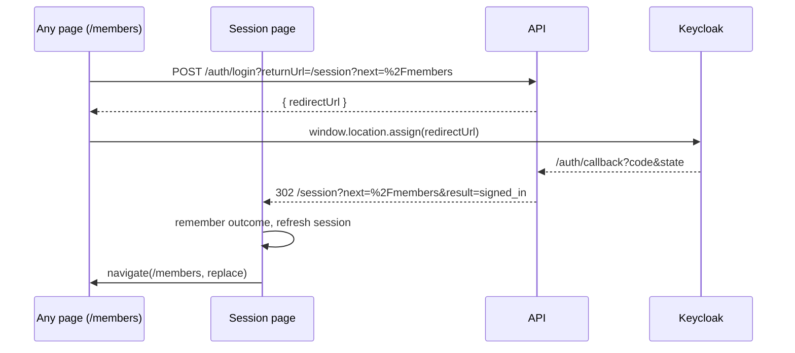

# Design: Web App Sign-In, Session and Tenants (GU-89)

Requirements: `requirements.md` in this folder. Web app only; no API change.

## Overview



All sign-ins return to the Session page, which handles every outcome in one place and then continues to `next` on success. The API's `CallbackRedirect` keeps the existing `next` value and adds the outcome after it.

## 1. Return logic (`features/session/returnTo.ts`)

```ts
export const OUTCOME_KEYS = ['result', 'alreadyMember', 'error', 'idpError', 'next'] as const;
export const MAX_NEXT_LENGTH = 1000;

/** True for a path in this app: single leading '/', not a proxied API path, not too long. */
export function isAppPath(value: string): boolean;

/** The page to come back to: path and query of `location`, without the outcome keys; null for the Session page itself. */
export function pageToReturnTo(location: { pathname: string; search: string }): string | null;

/** The returnUrl sent to the API: '/session' or '/session?next=<encoded page>'. */
export function buildReturnUrl(location: { pathname: string; search: string }): string;
```

- `isAppPath`: starts with `/`, second character is not `/` or `\`, contains no `\`, length ≤ 1000, and does not start with any entry of `proxiedPrefixes` (plain prefix, matching Vite's rule, so `/authors` is refused too).
- `pageToReturnTo` reads `window.location` values (not the router's parsed search) so the query is kept exactly; it removes the outcome keys with `URLSearchParams`, and returns null when the path is `/session` or the result is not an app path.
- `buildReturnUrl` encodes the page with `encodeURIComponent`. The longest value is `/session?next=` (14) plus the encoded page; with `next` capped at 1000 raw characters the encoded form can exceed 2048 only for pathological input, so `buildReturnUrl` drops `next` when the result would be over 2048 (the API's limit).

`sessionSearchSchema` (from GU-87) gains `next: z.string().refine(isAppPath).optional().catch(undefined)`.

## 2. Endpoint functions (`api/auth.ts`, types in `api/types.ts`)

```ts
login(options: { forceLogin?: boolean; returnUrl: string }): Promise<{ redirectUrl: string }>
signup(options: { organizationName?: string; returnUrl: string }): Promise<{ redirectUrl: string }>
setTenant(tenantId: string): Promise<void>
refreshSession(): Promise<void>                          // exists; return type tightened
createOrganization(name: string): Promise<CreatedOrganizationDto>   // { id, name, slug }
leaveTenant(tenantId: string): Promise<LeaveTenantResultDto>        // { success, currentTenantId }
logout(): Promise<{ logoutUrl: string }>
```

Query strings are built with `URLSearchParams` (`forceLogin=true` only when set; `returnUrl` always). Signup sends `{ organizationName }` only when a name is given (no name means simple sign-up).

## 3. Hooks (`features/session/`)

- `useStartSignIn()`: a mutation taking `{ kind: 'login' | 'signup', forceLogin?, organizationName? }`. It builds the return URL from `window.location`, calls `login` or `signup`, then `window.location.assign(redirectUrl)`. The pending state stays true until the page unloads, so the button keeps showing progress.
- `useSessionActions()`: mutations for set-tenant, refresh, create organization, leave and the two sign-outs. Each calls `onSessionChanged(queryClient)` on success. "Sign out everywhere" calls `logout()` and then `window.location.assign(logoutUrl)`; "Sign out of this app" calls `logout()` and `onSessionChanged`.

## 4. The Session page (`routes/session.tsx` and `features/session/components/`)

Layout, top to bottom:

| Section | Shown when | Content |
|---|---|---|
| `CallbackOutcome` | the page was opened with an outcome | the message (below); for `signed_in` with `next`, a short "Signed in, returning to …" before the navigation |
| `OrganizationsPanel` (first) | signed in, no current tenant, organizations to choose from | as below, with "Choose an organization to continue" |
| `SignedOutPanel` | signed out | Sign in; Sign in and ask for my password; Sign up and create an organization (name field); Sign up (default tenant note) |
| `SessionDetails` | signed in | user id, email, name, current tenant (name and id), roles, issued / expires / signed-in times (local, UTC on hover), time left; **Refresh token** |
| `OrganizationsPanel` | signed in (not already shown first) | one row per organization: name, slug, type, "current" chip; **Switch** (standard, switchable, not current); "Not switchable here" with the subdomain (enterprise or not switchable); **Leave** with a confirmation dialog naming the organization |
| `CreateOrganizationForm` | signed in | name (1 to 200 characters, trimmed); on success "Created X" with **Switch to it** |
| `SignOutPanel` | signed in | **Sign out of this app** (help: Keycloak may still sign you in without a password) and **Sign out everywhere** |

Each mutation's error shows in an `ErrorPanel` next to the action that failed.

**Landing handling.** On first render, the page copies the outcome values into component state (`useState(() => search)`), then in an effect:
1. calls `onSessionChanged(queryClient)` if there was an outcome
2. for `result=signed_in` with a valid `next`: `navigate({ href: next, replace: true })`
3. otherwise: `navigate({ to: '/session', search: {}, replace: true })`, so a reload shows no message but the message stays on screen (it is in state)

A ref guards the effect so React's development double render does not navigate twice.

**Messages** (`features/session/outcomeMessages.ts`, a plain map so it can be tested):

| Code | Message |
|---|---|
| `REAUTH_REQUIRED` | Your session is too old. Sign in again with your password. |
| `CSRF_STATE_MISMATCH` | The sign-in was finished in a different browser or tab from the one that started it, or took too long. Start again. |
| `FLOW_ALREADY_CONSUMED` | This sign-in was already completed. Start again if you are not signed in. |
| `FLOW_EXPIRED` | The sign-in took too long (over 10 minutes). Start again. |
| `IDP_ERROR` | Keycloak reported an error (`idpError` shown when present). |
| `ACCESS_DENIED` | You are not a member of this organization. |
| `NO_DEFAULT_TENANT` | Sign-up without an organization needs a default organization, and none is set. |
| `EMAIL_NOT_VERIFIED` | Verify your email address first (see the email from Keycloak), then sign in. |
| `INVITATION_EMAIL_MISMATCH` | The invitation was sent to a different email address than the one you signed in with. |
| anything else | The sign-in did not complete. |

Every error message has **Sign in again** (with `forceLogin` for `REAUTH_REQUIRED`).

## 5. Top bar, banner and error panel

- `SessionButton` in `AppLayout`, next to Requests: signed out → **Sign in** (`useStartSignIn` login); signed in → **Sign out** (sign out of this app).
- `SessionBanner`: the signed-out "Sign in" link becomes a button starting a sign-in.
- `ErrorPanel`: "Sign in again" for `REAUTH_REQUIRED` starts a sign-in with `forceLogin` returning to the current page (it used to link to `/session`). The component takes the start function from the hook, so `ErrorPanel` stays usable in the root error page (where the API is down, the button simply fails and shows nothing new).

## 6. Tests (Vitest, node environment)

- `api/auth.test.ts`: each endpoint function's method, path, query string (`forceLogin` only when true, `returnUrl` encoded) and body; `signup` without a name sends no body field; response types returned.
- `features/session/returnTo.test.ts`: `isAppPath` accepts `/`, `/members`, `/data?page=2`; refuses `//x`, `/\x`, `https://x`, `x`, `/api/x`, `/auth/callback`, `/authors`, `/swagger`, over 1000 characters. `pageToReturnTo` keeps the query, strips the outcome keys, returns null on `/session`. `buildReturnUrl` gives `/session` on the Session page and `/session?next=%2Fdata%3Fpage%3D2` elsewhere, and drops `next` when the result would exceed 2048.
- `features/session/sessionSearch.test.ts`: `next` kept for an app path and dropped otherwise.
- `features/session/outcomeMessages.test.ts`: each known code has a message; unknown codes get the generic one.

## 7. Testing manual

- Part 2 (return URL) uses the **Sign in** button: start from Members, sign in, land back on Members; the private-window check gives `CSRF_STATE_MISMATCH` on the Session page.
- Part 3 "Sign-in, session and organizations" follows the API guide's Parts 2 to 10 and 14.1 to 14.3 with the same users and states (Alice, Bob), done from the Session page. Steps that change settings (default tenant) keep the API guide's Recipe 3 until GU-91.
- The API guide's Parts 2 to 10 each get one line: "From the browser: web app TESTING.md Part 3.x".

## Files

New: `features/session/returnTo.ts`, `outcomeMessages.ts`, `useStartSignIn.ts`, `useSessionActions.ts`, `components/` (`CallbackOutcome`, `SignedOutPanel`, `SessionDetails`, `OrganizationsPanel`, `CreateOrganizationForm`, `SignOutPanel`), `components/SessionButton.tsx`, tests. Changed: `api/auth.ts`, `api/types.ts`, `routes/session.tsx`, `sessionSearch.ts`, `AppLayout.tsx`, `SessionBanner.tsx`, `ErrorPanel.tsx`, TESTING.md, the API guide. About 22 files, one PR.

Task groups:
1. Endpoint functions, return logic, messages, with tests.
2. The Session page, the top-bar button, banner and error panel changes.
3. Testing manual Parts 2 and 3, the API guide's pointers, a manual run, PR.
